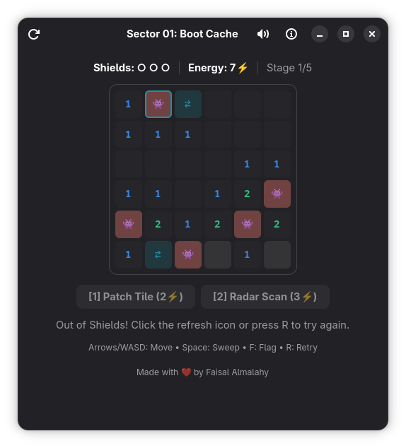

  
  <h1>ByteSweeper</h1>
  
<strong>Clear digital sectors and outsmart hidden glitches.</strong>

  
A fast-paced, tactical twist on classic grid-sweeping puzzles built natively for the Linux desktop with GTK4 and Libadwaita.

  

---

## Features

- **5 Progressive Sectors:** Climb from a quick `6×6` Boot Cache up to a `12×12` Core Matrix.
- **Shield System:** Survive accidental Glitch hits with 3 regenerating Shields per sector.
- **Tactical Power-Ups:** Collect Energy (`⚡`) as you sweep to trigger **Patch Tile** (neutralize a hidden Glitch safely) or **Radar Scan** (reveal Glitches in a `3×3` radius).
- **Warp Nodes (`⇄`):** Linked tiles that teleport your scan across the board.
- **Retro Synthesized Audio:** Crisp 8-bit sound effects generated in memory with zero external audio dependencies (includes a header-bar mute toggle).
- **Full Keyboard & Mouse Support:** Play with your mouse or entirely from the keyboard.

---

## Controls

| Action | Mouse | Keyboard |
| :--- | :--- | :--- |
| **Move Cursor** | Hover / Click | `Arrow Keys`, `W A S D`, or `H J K L` |
| **Sweep Tile** | Left-Click | `Space` or `Enter` |
| **Flag Glitch (`🚩`)** | Right-Click | `F` or `M` |
| **Patch Tile (`2⚡`)** | Click `[1] Patch Tile` | `1` |
| **Radar Scan (`3⚡`)** | Click `[2] Radar Scan` | `2` |
| **Retry Sector** | Click Refresh Icon | `R` |
| **Next Sector** | Click `Next Sector →` | `N` |

---

## Installation

Grab the latest packages for your distribution from the **[Releases Page](https://github.com/myrnop/ByteSweeper/releases/latest)**:

- **Flatpak (Universal Linux):** Download `ByteSweeper-1.0.0-x86_64.flatpak` and run `flatpak install ByteSweeper-1.0.0-x86_64.flatpak`
- **Fedora / RHEL (`.rpm`):** Download `bytesweeper-1.0.0-1.noarch.rpm` and run `sudo dnf install ./bytesweeper-1.0.0-1.noarch.rpm`
- **Ubuntu / Debian (`.deb`):** Download `bytesweeper_1.0.0_all.deb` and run `sudo apt install ./bytesweeper_1.0.0_all.deb`

---

## License

Licensed under the **GPL-3.0-or-later** License. See [LICENSE](LICENSE) for details.

Made with ❤️ by **Faisal Almalahy**
